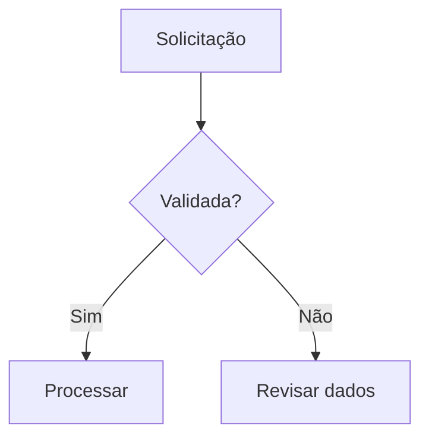
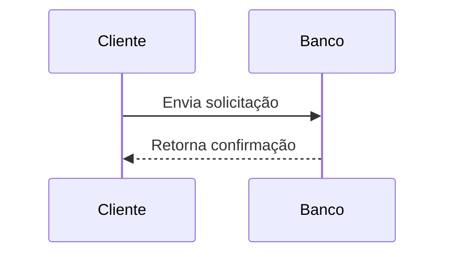

# Mermaid diagrams in the chat

The frontend uses Mermaid 12.3.0 and its `parse`/`render` API.
Keep the first line as a diagram type and avoid directives or embedded config;
the host controls layout, theme, and security. Mermaid's documented types
include flowcharts, sequence, state, class, entity relationship, journey,
gantt, pie, mindmap, timeline and others supported by the installed release.

Avoid malformed: `flowchart TD A -->` (missing destination). Prefer simple IDs
without punctuation and quote complex visible labels, e.g. `A["Taxa (a.m.)"]`.
Mermaid syntax evolves with its package version; frontend tests parse definitions
using the installed parser. The UI offers source copy and shows an accessible
text fallback when parser or render errors occur.
